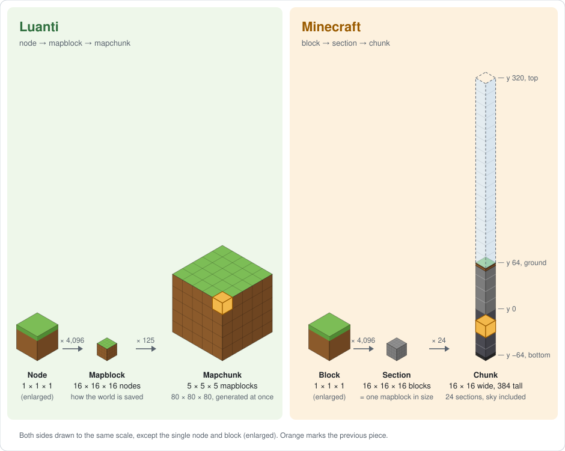

# Antichunk

Antichunk is a seed map for [Luanti](https://www.luanti.org/) worlds made 
with [Mineclonia](https://content.luanti.org/packages/ryvnf/mineclonia/). 
It is a webpage that shows the terrain of a Luanti world (v7, v5, Flat,
Valleys or Carpathian mapgen, default settings) from its seed, like Chunkbase does for
Minecraft.

**Live demo: [buddyhollyy.github.io/Antichunk](https://buddyhollyy.github.io/Antichunk/)**

## How to open it

Open `index.html` in a web browser (double-click it). It needs no server and
no internet connection. Type the seed exactly as it was typed when the world
was created, pick the map generator the world uses under "Mapgen" (v7, v5, Flat
with the Lakes and Hills options it was made with, Valleys, or Carpathian
with or without Rivers), then press "Show map".
Valleys has four options of its own (Altitude chill, Altitude dry, Humid
rivers, Vary river depth; all on by default) under "World settings" at the
bottom of the layers panel. You can find the seed in game by pressing
'F5' on the keyboard. Drag to move, use the mouse wheel or the + / − buttons to 
zoom (or pinch zoom on touch screens). The address bar keeps the seed and
position, so a bookmark brings you back to the same view.

Click any icon on the map to select it. A card displays a short description of the
item (with a link to its Minecraft Wiki article), shows its position, how 
accurate that position is, and the `/locate` command to check it in game. At the
bottom are buttons to copy locate and teleport commands to this item. 

## Accuracy

The JavaScript output was checked against Luanti's own C++ noise code
compiled from source. In every column tested, the surface height matched
exactly, and so did the biome (the biome check used a copy of Luanti's
biome-choice function with the real noise and random-number code).

Known limits:
- It assumes default world settings, apart from the options you can pick on
  the page (Flat's Lakes and Hills, Valleys' four options, Carpathian's
  Rivers). Mineclonia's "classic superflat" is not supported.
- Caves are not modeled. A cave that opens at the surface will not show.
- It matches x86-64 builds of Luanti. Some ARM builds could round
  differently in rare cases.

## License

The terrain and biome code is ported from Luanti (LGPL-2.1-or-later). The
biome list comes from Mineclonia (GPL-3.0), so the finished page as a whole
should be shared under GPL-3.0.

## Build

index.html is built from the files in src/ and js/ by running node tools/build.js.

## Why "Antichunk"

The name is a nod to [Chunkbase](https://www.chunkbase.com/apps/seed-map), the seed
map for Minecraft. Minecraft and Luanti cut their worlds into pieces in different ways:

#### Luanti: 
* Luanti node: one 1 × 1 × 1 cube, the smallest piece of a Luanti world.
* Luanti mapblock: a cube of 16 × 16 × 16 nodes. This is how the world is stored. Seen from above it has the same footprint as a Minecraft chunk, but it is only 16 nodes tall, so mapblocks stack on top of each other.
* Luanti mapchunk: 5 × 5 × 5 mapblocks, so 80 × 80 × 80 nodes. The map generator builds the world one mapchunk at a time.

#### Minecraft: 
* Minecraft block: one 1 × 1 × 1 cube, like a Luanti node.
* Minecraft section: 16 × 16 × 16 blocks, the same size as a mapblock.
* Minecraft chunk: a column of 24 sections, 16 × 16 blocks wide and 384 blocks tall: the whole height of the world. The game generates, loads and saves the world one chunk at a time.

Luanti itself has no Minecraft-style chunks, so a Luanti seed map is an "anti-chunk" map.

Here is a visual of Luanti node, mapblock and mapchunk next to Minecraft block, section and chunk, drawn to scale:

